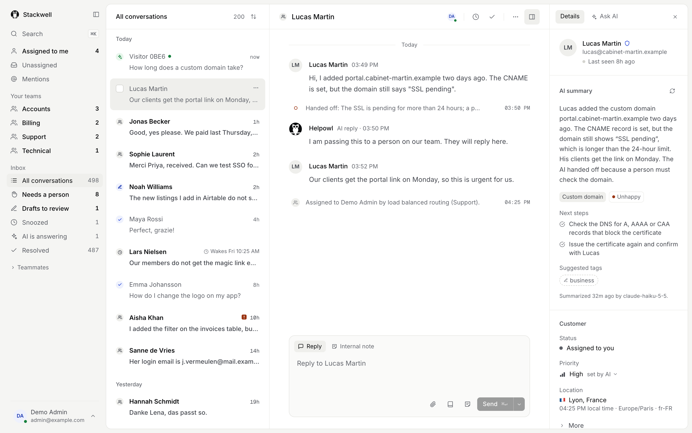
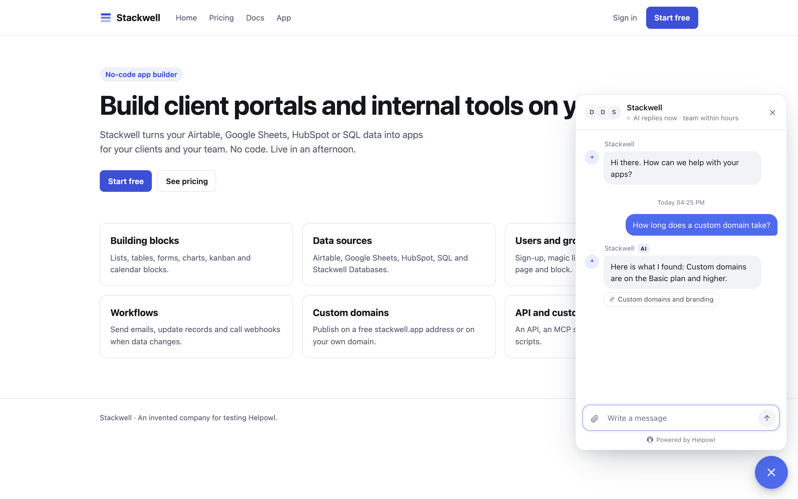

<picture>
  <source media="(prefers-color-scheme: dark)" srcset="assets/logo-dark.svg">
  
</picture>

<h1>Helpowl</h1>

<strong>The open-source AI agent for customer support.</strong> 
It answers customers from your knowledge, follows your rules, and hands the hard cases to your team, 
in a complete helpdesk that you can host yourself.

<picture>
  <source media="(prefers-color-scheme: dark)" srcset="assets/inbox-dark.png">
  
</picture>

- **Answers with sources.** The AI answers from your help center, documents and past replies, and checks each answer against its sources.
- **Hands off with context.** When a person must decide, the right teammate gets the conversation with a summary and next steps.
- **A complete helpdesk.** Inbox, chat widget, email, reports and imports from Intercom and Zendesk.
- **Open source, your choice of model.** The core is MIT. Use Anthropic, OpenAI, Google or a local model, and host it yourself.

**Status:** early development. The code opens with the public launch. The screenshots show an invented demo company.
